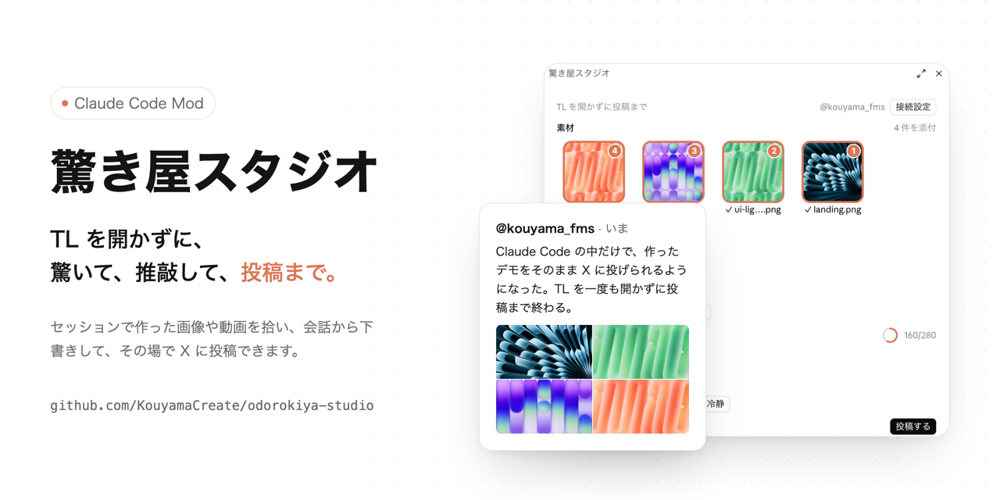

# 驚き屋スタジオ (odorokiya-studio)



Claude Code で作ったデモ画像やデモ動画を、TL を一度も開かずに X へ投稿するための Mod です。

X を開くと、つい TL を眺めてしまい、驚きの鮮度が落ちます。驚き屋スタジオは Claude Code の画面の中に投稿パネルを出し、下書き、推敲、素材の添付、投稿までをそこで終わらせます。TL、通知、他人の投稿は一切読み込みません。

## できること

- **素材を自動で拾う**: セッション中のツール入出力に出てきた画像・動画(png / jpg / gif / webp / mp4 / mov / m4v / webm)のパスを集め、サムネイル付きで並べます。
- **会話から下書き**: いまの会話で何を作ったかを Claude が読み、驚き屋ツイートの案を 3 つ出します。
- **推敲**: 書いた本文を「MAX」「短く」「技術寄り」「冷静」の方針で書き直した案を出します。
- **投稿プレビュー**: X と同じ割り付けで画像を並べ、文字数を X と同じ重み付け(日本語 2、英数 1、URL 23)の概算で数えます。
- **驚き屋チャンス**: 画像や動画ができると、入力欄の上に最新の素材とツイートボタンが出ます。押すと最新の 1 件だけを添付した状態でパネルが開きます。
- **Claude に頼む**: 「これツイートの下書きにして」と頼むと、Claude が本文と素材をパネルに入れます。投稿はしません。

投稿は、パネルの「投稿する」ボタンを本人が押したときだけ行われます。Claude が自分の判断で投稿することはありません。

## 動作環境

- Claude Code 2.1.295 以降(Mod の API は早期アクセスです。今後のリリースで変わる可能性があります)
- macOS。サムネイル作成に `sips` と `qlmanage`、鍵の保存にキーチェーン、補助スクリプトの実行に `/usr/bin/python3` を使います
- X Developer Console のアプリ。権限は **Read and write** にしてください
- X API は従量課金です。投稿やメディアのアップロードにクレジットが必要になる場合があります

パネルの見た目は Claude Code デスクトップアプリ(Code タブ)向けに作っています。ターミナルでも動きますが、サムネイルは出ません。

## インストール

Claude Code をターミナルで開き、次を入力します。

```
/plugin install odorokiya-studio --marketplace KouyamaCreate/odorokiya-studio
```

マーケットプレイスを追加するか聞かれたら `y` を押し、スコープは `user` を選びます。user スコープで入れると、デスクトップアプリの Code タブのセッションでも読み込まれます。

## X とつなぐ

最初の 1 回だけ、X Developer Console でアプリを作って 4 つの鍵を渡します。

`/odorokiya-studio` でパネルを開くと、まだつながっていない場合は「X とつなぐ」の案内が出ます。案内のとおりに進めれば、ターミナルを開かずに済みます。

1. **アプリを作る**: パネルのリンクから [X Developer Console](https://console.x.com) を開き、New App でアプリを作ります。名前は何でも構いません。
2. **投稿できる権限にする**: アプリの User authentication settings で、次のように設定して保存します。
   - App permissions: **Read and write**
   - Type of App: Web App, Automated App or Bot
   - Callback URI: `http://127.0.0.1/callback`(必須項目ですが、この Mod は使いません。パネルにコピーボタンがあります)
   - Website URL: 自分の X のプロフィール URL など
3. **鍵を発行して貼る**: Keys and tokens で API Key と API Secret、続けて Access Token と Access Token Secret を発行し、パネルの 4 つの欄に貼って「保存して接続テスト」を押します。`@ユーザー名` とつながれば完了です。

Access Token は、必ず手順 2 で権限を変えたあとに発行してください。先に発行したトークンは読み取り専用のままで、投稿すると断られます。

### 鍵の置き場所

パネルから保存した鍵は、macOS のキーチェーン(service 名 `odorokiya-studio`)に入ります。鍵の扱いの詳細と、防げること・防げないことは「[セキュリティ](#セキュリティ)」と [SECURITY.md](SECURITY.md) にまとめています。

ほかの渡し方もあります。

- **プラグインの設定画面**: インストール時に出る設定画面で 4 つの鍵を入れると、Claude Code の安全な保存場所に入ります。設定画面の鍵はキーチェーンより優先されます。
- **ターミナルからキーチェーンに入れる**: 次を実行し、聞かれた順に値を貼ります(`consumer_key` が API Key、`consumer_secret` が API Secret)。

```bash
for k in consumer_key consumer_secret access_token access_token_secret; do printf "%s: " "$k"; read -rs v; echo; security add-generic-password -U -s odorokiya-studio -a "$k" -w "$v"; done; unset v
```

### つながらないとき

パネルと `/odorokiya-studio-check` は、X の返事を原因と直し方の言葉にして出します。

| 表示 | 原因 | 直し方 |
| --- | --- | --- |
| 鍵が正しくありません(401) | 4 つの値のどれかが違う | API Key と Access Token の取り違え、前後の空白、再発行前の古い値を確認する |
| トークンが読み取り専用です(403) | 権限を変える前に発行したトークン | Read and write にしたあと Access Token を再発行し、入れ直す |
| クレジットが足りません(402) | X API の従量課金の残高不足 | X Developer Console の Billing を確認する |
| 回数制限に当たりました(429) | 短時間に呼びすぎ | 少し待ってから試す |

## 使い方

| 操作 | 内容 |
| --- | --- |
| `/odorokiya-studio` | 驚き屋スタジオを開く。引数を付けると本文の初期値になる |
| `/odorokiya-studio-check` | X とつながっているか確認する |
| `/odorokiya-studio-security` | 鍵の扱いとセキュリティの説明を表示する |
| 入力欄の上の「TLを見ずにツイート」 | 最新の素材 1 件を添付してパネルを開く |
| 「これツイートの下書きにして」と Claude に頼む | Claude が下書きツールで本文と素材をパネルに入れる |

添付は画像なら 4 枚まで、GIF と動画は 1 本だけです(X の制限)。画像は 5MB、GIF は 15MB までです。

## 設定項目

| 項目 | 既定値 | 内容 |
| --- | --- | --- |
| X API Key / Secret / Access Token / Secret | 空 | 空ならキーチェーンを読みます |
| キーチェーンの鍵を読むたびに確認する | オフ | オンにしてパネルから鍵を保存し直すと、読み出しのたびに macOS の確認が出る |
| 推敲に使うモデル | `sonnet` | 推敲ボタンが使うモデル(`sonnet` / `haiku` / `opus`) |
| 入力欄の上に「驚き屋チャンス」を出す | オン | オフにすると帯を出しません |

## この Mod が実行するもの、送るもの、読むもの

公開ディレクトリの審査と利用者の確認のため、すべて書いておきます。

**外部への送信**

- `https://api.x.com` だけに送ります。使うのは次のエンドポイントです。
  - `GET /2/users/me`(認証確認と投稿後の URL 作成)
  - `POST /2/media/upload/initialize`、`/2/media/upload/{id}/append`、`/2/media/upload/{id}/finalize`、`GET /2/media/upload?command=STATUS`(添付ファイルのアップロード)
  - `POST /2/tweets`(投稿)
- 送るのは、本人が投稿ボタンを押したときの本文と選んだ添付ファイル、そして認証の確認に必要な署名だけです。
- 下書きと推敲の文章は、Claude Code 自身のモデル呼び出し(`$.model.fork` と `$.model.complete`)で作ります。会話の内容はこの経路で Claude に渡ります。X 以外の第三者には送りません。

**手元で実行するコマンド**

すべて `scripts/odorokiya.py` から、シェルを通さずに実行します。

- `/usr/bin/python3 -I scripts/odorokiya.py`(補助スクリプト本体。Python 標準ライブラリだけを使い、追加のパッケージは入れません)
- `/usr/bin/sips`(画像を 320px の JPEG サムネイルにする)
- `/usr/bin/qlmanage`(動画の 1 コマを取り出す)
- `/usr/bin/mdls` と、入っていれば `ffprobe`(動画の長さを読む)
- `/usr/bin/security find-generic-password`(キーチェーンから鍵を読む)
- `/usr/bin/security -i`(パネルで入れた鍵をキーチェーンに保存する。鍵は標準入力で渡す)
- `/usr/bin/security delete-generic-password`(「読むたびに確認」をオンにして保存し直すとき、古い項目を消す)

**Claude Code の中で止めるもの**

- Claude が Bash で、この Mod の鍵をキーチェーンや環境変数から読み出すコマンド(`security find-generic-password -s odorokiya-studio` など)を実行しようとしたときは、`tool.call` フックで拒否します

**読むもの、保存するもの**

- セッション中のツール入出力に出てきたパスのうち、メディアの拡張子を持つファイルの情報(存在、大きさ)
- 素材の一覧、サムネイル、下書きは、そのセッションの間だけ Claude Code の state に保持します。ディスクには書きません(サムネイル作成時の一時ファイルは、作成後すぐ消します)
- TL、通知、DM、他人の投稿は読みません

## セキュリティ

X の鍵は、あなたとして投稿できる鍵です。Mod は次のように扱います。全文は [SECURITY.md](SECURITY.md) にあり、インストール後も `/odorokiya-studio-security` かパネルの「鍵の扱いとセキュリティについて」で読めます。

- 入力中の鍵は Mod のメモリだけに持ち、state やディスクには書きません。保存を押したら、成否にかかわらず消します
- 補助スクリプトとキーチェーンへは標準入力で渡し、コマンドライン引数には載せません
- 保存先は macOS のキーチェーンです。送るのは X API への署名だけで、鍵そのものは送りません
- Claude が Bash でこの Mod の鍵を読み出すコマンドを実行しようとすると、Mod が止めます(書き方を工夫したコマンドまでは見分けられません)
- 投稿は、パネルの「投稿する」をあなたが押したときだけです

防げないこともあります。入力欄の文字は他のプラグインのフックを通り、保存するまで画面に表示されます。標準の設定では、同じユーザーで動く他のプログラムがキーチェーンの鍵を読めます。気になる場合は、設定の「キーチェーンの鍵を読むたびに確認する」をオンにするか、SECURITY.md にあるターミナルでの入れ方を使ってください。

## 既知の制約

- 文字数は X の数え方の概算です。絵文字や一部の記号で、実際の数とずれることがあります。
- デスクトップアプリは、Mod が指定した背景色を描画しません。パネルの背景はアプリ側の色になります。
- 動画は X 側の処理が終わるまで待つので、長い動画は投稿に時間がかかります(最大 10 分で打ち切り)。

## 開発

```bash
claude plugin validate .
```

```bash
claude plugin test .
```

ローカルのフォルダから読み込んで試すときは、`~/.claude/settings.json` の `env` に `"CLAUDE_CODE_PLUGIN_DIRS": "<このリポジトリの絶対パス>"` を入れます。デスクトップアプリで保存のたびに読み直したい場合は、`"CLAUDE_CODE_PLUGIN_DIR_WATCH": "1"` も入れます。

## English

Odorokiya Studio is a Claude Code mod for posting demo images and videos to X without opening your timeline. It collects media files that appear in the session, drafts and polishes a post from the conversation, previews it, and posts it through the X API v2 when you press the post button. It never reads the timeline, notifications or other people's posts. It requires macOS and an X developer app with Read and write permission. See the Japanese sections above for setup and for the full list of what it runs and sends.

## ライセンス

MIT
